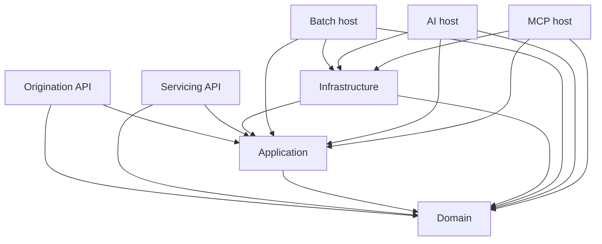

# Current solution structure

Reviewed against the working tree on 2026-10-20. Consult [delivery status](../status.md) for the latest tested scope.

The solution contains eight source projects, six test projects and two benchmark projects. Projects are organized by architectural layer; origination, servicing, risk and AI are conceptual boundaries, not independently implemented services.

| Project | Kind | Current responsibility |
|---|---|---|
| Promissio.Domain | Library | Value objects, day counts, interest, schedules, dated APRC, loan lifecycle and event replay |
| Promissio.Application | Library | MediatR creation, activation and aging workflows; authoritative persistence port; loan-summary contract, query and read port |
| Promissio.Infrastructure | Library | Marten loan repository, atomic handoff receipt, inline loan-summary projection, document reader and offline rebuilder; no EF Core model |
| Promissio.Api.Origination | Web host | Empty HTTP application; no business routes or Scalar UI |
| Promissio.Api.Servicing | Web host | Empty HTTP application; no business routes or Scalar UI |
| Promissio.BatchProcessor | Generic host executable | Starts and stops a host; no scheduled jobs or financial batch work |
| Promissio.AI | Web host | Reserved agent runtime; development OpenAPI only, no agents |
| Promissio.AI.McpServer | Web host | Reserved MCP boundary; no MCP transport, tools or authorization wired |

## Project references today

Arrows below mean compile-time references, not network calls.

Infrastructure references Application to implement its loan persistence port and reaches Domain transitively through that contract. APIs do not yet compose Infrastructure. Domain references NodaTime only, and Application has no dependency on persistence or transports.

## Runtime and tests

Docker Compose defines PostgreSQL, Qdrant and Jaeger dependencies; it does not launch the application hosts or Langfuse. Domain, Application and Infrastructure unit verification require no database. The Integration suite requires a working Docker endpoint for its PostgreSQL Testcontainer. AI evaluations remain a placeholder, not coverage.

Application tests cover creation, activation, aging and the loan-summary query. PostgreSQL Testcontainers scenarios cover authoritative persistence, idempotency, optimistic concurrency, immediately visible summary updates, rebuild/backfill and preservation of handoff receipts. See delivery status for the latest execution results. Endpoint behavior, batch idempotency and AI evaluations remain future work.

## Loan query data

`LoanSummary` is derived query data, maintained inline in the same PostgreSQL transaction as each append. It exposes original principal rather than an outstanding balance and follows stream order. Commands continue using `ILoanRepository`; queries use `ILoanSummaryReader`. Summaries can be rebuilt with `LoanSummaryRebuilder` during offline maintenance, preserving streams and handoff receipts. Existing streams require a backfill before summary reads are enabled. [ADR-0009](../adr/0009-loan-summary-projection.md) defines the consistency, rebuild and event compatibility policies. Historical business-effective queries remain unimplemented.

Both benchmark projects are in the solution so their API drift becomes a build failure. Their scopes and commands are documented in [benchmarks](../../benchmarks/README.md).
